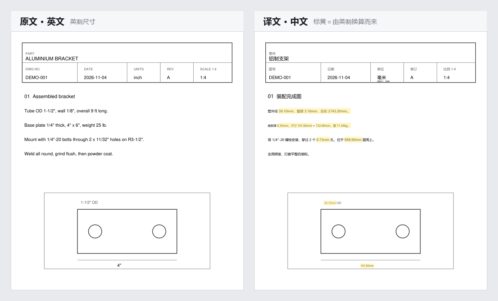

# PDF Drawing Translator

Translate engineering drawings (PDF) between Chinese and English without changing the
layout. Text is replaced at its original position, dimensions are converted to the unit
system you select, and a second copy marks every value that was changed so it can be
checked one by one.



## Contents

- [Overview](#overview)
- [Features](#features)
- [Requirements](#requirements)
- [Installation](#installation)
- [Quick start](#quick-start)
- [Output files](#output-files)
- [Translation engine](#translation-engine)
- [Data sent over the network](#data-sent-over-the-network)
- [Unit conversion](#unit-conversion)
- [Known limitations](#known-limitations)
- [How it works](#how-it-works)
- [Development](#development)
- [License](#license)

## Overview

Machine translation of a drawing returns plain text with the layout destroyed. Rebuilding
a multi-view sheet by hand takes hours, and the dimensions still carry the original unit:
a callout reading `1-1/2"` stays `1-1/2"` in a document that is now in Chinese.

This program does three things together. It replaces the text in place, converts the
dimensions, and marks every number it has changed. Doing the first two without the third
produces a drawing that is confidently wrong: a workshop reading `38.10` under a title
block marked inch will order 38.10 inches, which is twenty-five times the material.

## Features

- Text is re-typeset at the original position, angle, colour and size. No vector on the
  sheet moves.
- Unit conversion in both directions (imperial to metric, metric to imperial), or no
  conversion at all.
- A second PDF marks every converted value, so a checker can compare it with the source
  at a glance.
- The source text is recomputed and compared with the translation. Wrong numbers are
  corrected; doubtful ones are listed for a human.
- The unit field in the title block is rewritten together with the numbers, with a short
  note naming the original unit.
- Output language and output units are separate settings.
- Interface available in Chinese and English, switchable at runtime.
- Three translation channels: local glossary, AI endpoint, free machine translation.
- Can run entirely offline when pointed at a local model (ollama, LM Studio, vLLM).

## Requirements

| Use | Requirement |
|---|---|
| Installer | Windows 10 or later, 64-bit |
| From source | Python 3.10 or later (developed on 3.14), with tcl/tk |
| AI endpoint | Any OpenAI-compatible API; optional, the program works without one |

On Windows, use the full python.org installer. The Microsoft Store build has no tkinter
and cannot open the window.

## Installation

### Installer

Download `PDFTranslator_Setup_x.y.z.exe` and run it. Shortcuts are created on the desktop
and in the Start menu. The install is per-user and does not request administrator rights.
Uninstalling from Settings, Apps removes it cleanly.

To check that the environment is healthy, run the built-in self-test (offline, free, a few
seconds):

```
"%LOCALAPPDATA%\Programs\PDFDrawingTranslator\PDF图纸翻译.exe" --selftest
```

It checks the data folder, system fonts, PDF reading and writing, both conversion
directions and preview rendering. The result is shown in a dialog and written to
`%APPDATA%\PDFDrawingTranslator\data\selftest.log`.

### From source

```bash
git clone https://github.com/<your-name>/pdf-drawing-translator.git
cd pdf-drawing-translator
python -m pip install -r requirements.txt
python app.py
```

## Quick start

1. Drop PDF files onto the window, or click the drop area to select them. Several files
   can be queued at once.
2. Choose the source and target language and the output units.
3. Press Start.

Each PDF produces its own output folder. Re-running the same file never overwrites an
earlier run; the folder name gets a `_1`, `_2` suffix instead.

## Output files

```
BR-01-Fence-Brace/
├── BR-01-Fence-Brace.pdf                  copy of the source
├── [Translated] BR-01-Fence-Brace.pdf     the working file
├── [Marked] BR-01-Fence-Brace.pdf         converted values highlighted
├── [Untranslated] BR-01-Fence-Brace.txt   items that were not translated
├── [Preview] BR-01-Fence-Brace.png        first page as an image
└── [Data check] ....txt                   only when a converted value could not be verified
```

With the interface set to Chinese, the prefixes become `【翻译】`, `【标注】`, `【未译清单】`,
`【预览】` and `【数据校验清单】`. The folder always uses the same language as the interface.

## Translation engine

Three channels are tried in order. The first one that produces an acceptable result wins.

| Order | Channel | Used for | Notes |
|---|---|---|---|
| 1 | Cache | any sentence translated before | identical to the previous result |
| 2 | Local glossary | short callouts such as parts, fasteners, fittings | most consistent terms, no cost |
| 3 | AI endpoint | long sentences, technical notes | best quality, billed per token |
| 4 | Free machine translation | only when no endpoint is configured | fair quality, daily quota |

No API key ships with the program. Without one, the glossary and the free fallback cover
short callouts, but long technical notes come out rough.

To configure an endpoint, open Settings, AI API, choose a provider, paste the key and
press Test connection.

| Provider | Base URL | Notes |
|---|---|---|
| DeepSeek | `https://api.deepseek.com/v1` | cheapest, balance query supported |
| OpenAI | `https://api.openai.com/v1` | |
| Moonshot (Kimi) | `https://api.moonshot.cn/v1` | balance query supported |
| Alibaba Qwen | own compatibility URL | fast |
| Zhipu GLM | own compatibility URL | free models available |
| SiliconFlow | own compatibility URL | balance query supported |
| Local model | `http://127.0.0.1:11434/v1` | ollama, LM Studio, vLLM |
| Custom | any OpenAI-compatible URL | |

The key is stored only in `%APPDATA%\PDFDrawingTranslator\data\config.json`. It is never
uploaded, and `.gitignore` keeps it out of the repository.

### Running the model on your own machine

Select Local model (ollama, LM Studio, vLLM) as the provider. Three things differ from a
cloud provider, and the program handles all three.

1. No API key. The field may stay empty; the request goes out without an `Authorization`
   header, which is what ollama expects.
2. No preset model names. Which models exist depends on what you have pulled, so the list
   would be a guess. Press Test connection instead: the models your server reports are
   read back and the first one is filled in.
3. No cost. The usage line reads "local model, no cost" instead of estimating a cloud
   price for hardware you already own.

Loopback addresses and private LAN ranges (`10.x`, `192.168.x`, `172.16` to `172.31.x`)
are treated as local. Such addresses bypass the system proxy on purpose, because an
internal endpoint swallowed by a proxy is the most common "the server is running but the
app cannot reach it" report. A vLLM server on the company LAN can go under Custom with an
empty key; the rule follows the address, not the provider name.

Local models are slower than cloud ones. Set items per batch to about 10 so a single slow
response does not stall a large batch.

### Cost

The status strip on the main window shows the model in use, the account balance, and the
tokens and estimated cost of the current run. Per-file usage and the running total are
written to the log. Prices are approximations of published rates and are editable in
`data/prices.json` in the form `{"model": [input_price, output_price]}`, in currency units
per million tokens. The provider's invoice is authoritative.

As a reference, a 7-page drawing with 150 callouts uses about 40k input tokens and 6k
output tokens, roughly ¥0.12 on DeepSeek. A second run of the same file is mostly served
from cache.

## Data sent over the network

Only the text that has to be translated is sent. The PDF itself, its images, its layout,
its file name and its folder path never leave the machine.

| Step | Sent | Not sent |
|---|---|---|
| PDF parsing and writing | nothing; PyMuPDF runs locally | the file |
| OCR for scanned pages (`rapidocr-onnxruntime`) | nothing; the model ships with the program | the scanned image |
| Unit conversion, arithmetic checks, marked copy, preview | nothing; all local | |
| AI endpoint, cloud | the text of each item, the target language, matched glossary entries, a fixed system prompt | file name, page number, coordinates, images |
| AI endpoint, local | the same fields, to `127.0.0.1` | |
| Free fallback (MyMemory) | one item's text, truncated to 480 characters, plus the language pair | |

A single request carries up to 30 items, three requests in flight at a time:

```json
[{"id": 0, "text": "3/8\" clevis pin, zinc plated", "target": "Chinese"}]
```

Two details are worth naming.

- Glossary hits. Entries from your `glossary.csv` that actually appear in the batch are
  sent as hints, capped at 60. Entries that do not appear are not sent.
- Title block text. Company names, customer names and project names are text like any
  other, so whatever needs translating in the title block is sent. The most identifying
  part of a drawing is also the part that leaves first.

If no endpoint is configured, the free fallback is used, and it is a third-party public
service. Free does not mean private. If a cloud endpoint fails part-way through a file,
the remaining items keep their original text rather than being pushed to the free service,
so one drawing is never split across two providers.

Two local files are worth knowing about:

- `%APPDATA%\PDFDrawingTranslator\data\cache.json` holds source and translation pairs in
  plain text, up to 20,000 entries. It is a readable copy of your text; delete it before
  handing the machine to someone else.
- `config.json` holds the API key in plain text.

To keep everything on one machine, select the local provider. The only traffic then is
loopback.

## Unit conversion

Imperial to metric, recognised forms:

| Source | Result | Note |
|---|---|---|
| `4"` | `101.60mm` | |
| `4″` | `101.60mm` | typographic inch sign |
| `4”` `4“` | `101.60mm` | full-width quotes produced by Word and InDesign |
| `4''` | `101.60mm` | two single quotes are inches, not feet |
| `4 in.` `4in` `4 IN` | `101.60mm` | abbreviation |
| `1-1/2"` | `38.10mm` | mixed fraction |
| `1 1/2"` | `38.10mm` | mixed fraction, space separated |
| `8'` | `2438.40mm` | feet |
| `2'-0"` | `609.60mm` | feet and inches, converted as one value |
| `9 ft` `9英尺` | `2743.20mm` | |
| `25 lb` `8 oz` | `11.34kg` `0.227kg` | mass always goes to kilograms |
| `R3-1/2"` | `R88.90mm` | radius, diameter and thickness prefixes are understood |

Metric to imperial uses fractional inches, because that is what a workshop reads off a
tape measure: `38.10mm` becomes `1-1/2"`, `8.73mm` becomes `11/32"`. Values that no
denominator up to 64 divides evenly fall back to decimals: `2000mm` becomes `78.74"`, never
`78-47/64"`. Small tolerances keep their significant digits: `0.05mm` becomes `0.002"`,
never `0"`.

Lengths are written with two decimals. Mass is written with two decimals, and with three
below 1 kg, so that `1 oz` is not rounded to `0.03kg`.

The following are deliberately not converted, because converting them orders the wrong
part:

- Gauge numbers: `11 ga`, `14 ga`
- Thread and fitting designations: `1/4"-20 UNC`, `NPT 1/2"`, `BSP 3/4"`
- Standard numbers, sizes and angles: `M8×30`, `DN50`, `SCH40`, `Rev E`, `38°`
- The preposition "in" inside a sentence: `1 in the box` is left alone

## Known limitations

- PDFs whose text has been converted to outlines cannot be translated directly. Some CAD
  exports draw the text as graphics, leaving neither a text layer nor any bitmap. The
  program detects this, says so, and skips the file by default rather than producing a
  translation identical to the original. Choosing image mode recognises each page and
  writes over the original, at the cost of compressed font sizes and labels that may cover
  drawing lines. A clean result requires the drawing to be re-exported with text kept as
  text.
- Selectable text only. Scanned or image-only drawings have no text layer. With
  `rapidocr-onnxruntime` installed the bitmaps are recognised, at lower accuracy than real
  text.
- A bare lowercase `12 in` with a space and no period is not recognised, because `in` is
  far too often a preposition. `4in`, `4 in.` and `4 IN` are recognised.
- Text sitting on a busy background is left alone rather than repainted, and listed as
  untranslated.
- PDF only. DWG and DXF are not supported.
- Every run ends with a reminder in the log: machine translation and automatic conversion
  can both be wrong, and quoting or machining straight from the output can cost real
  money.

## How it works

1. Extract. Cluster text spans into semantic blocks and merge wrapped lines into
   paragraphs.
2. Detect. Classify each block as Chinese, English or skip.
3. Translate. Cache, local glossary, AI endpoint (batched and concurrent), free machine
   translation, keep the original.
4. Check numbers. The digits in the translation must match the source, otherwise the item
   is retried.
5. Convert units. Pattern recognition, exact decimal arithmetic, fixed decimal places.
6. Verify. Recompute from the source, compare, correct or warn.
7. Write back. Erase the original, re-typeset in place, subset the font.

Conversion is never delegated to the model. A language model asked to multiply 3/8 inch by
25.4 will sometimes answer 9.5, and occasionally reads `1-1/2` as half of 1.5. Every
conversion runs locally on exact decimals; the model only translates words.

## Development

Build:

```bash
python -m pip install pyinstaller
python -m PyInstaller packaging/PDFTranslator.spec --noconfirm

# the installer needs Inno Setup 6: https://jrsoftware.org/isdl.php
"C:\Program Files (x86)\Inno Setup 6\ISCC.exe" packaging\installer.iss
```

The build excludes the OCR engine, which saves about 100 MB, and excludes any user
configuration.

Tests:

```bash
python tools_test_metrics.py     # 134 unit, conversion and verification cases
python tools_check_i18n.py       # every T("...") string has an English entry
python app.py --selftest         # end-to-end smoke test, offline
```

Run these before sending a pull request that touches conversions. The cases cover every
notation variant seen in real drawings, in both directions.

## License

[MIT](LICENSE)
