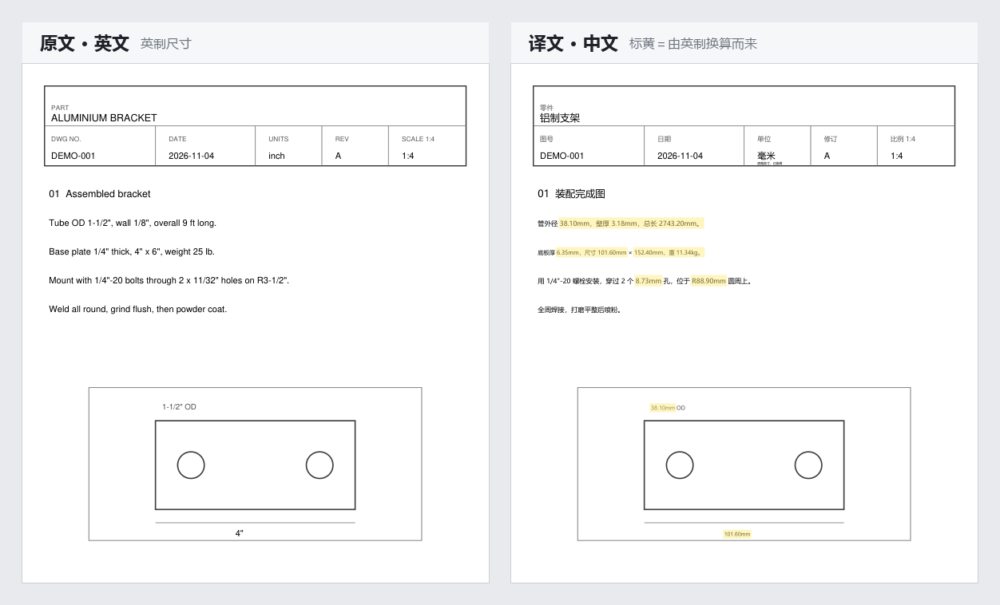

# PDF 图纸翻译工具

在 PDF 图纸上直接替换文字，把中文译成英文、英文译成中文，图形的线条、版式、位置和字
号都不动。尺寸按你选择的单位制换算，另出一份标注版，把每个被换过的数值标出来，方便逐
处核对。

[English](README.md)



## 目录

- [概述](#概述)
- [功能](#功能)
- [环境要求](#环境要求)
- [安装](#安装)
- [快速开始](#快速开始)
- [输出文件](#输出文件)
- [翻译通道](#翻译通道)
- [联网时发出什么](#联网时发出什么)
- [单位换算规则](#单位换算规则)
- [已知限制](#已知限制)
- [内部流程](#内部流程)
- [开发](#开发)
- [许可](#许可)

## 概述

把图纸丢给机器翻译，拿回来的是一堆没有排版的纯文字。多视图图纸手工重排，一张图就是
半天，而且尺寸仍然是原来的单位：原文写 `1-1/2"`，译完还是 `1-1/2"`，只不过整份文档
已经是中文了。

本工具把三件事一起做：原地替换文字、换算尺寸、把每个改动过的数值标出来。只做前两件、
不改单位栏，会得到一份看起来正常、实际错误的图：车间在标着 inch 的图框下看到 `38.10`，
会按 38.10 英寸下料，材料差二十五倍。

## 功能

- 文字按原位置、角度、颜色、字号重新排版，图上一个矢量都不动
- 尺寸双向换算（英制转公制、公制转英制），也可以完全不换算
- 另出一份标注版，把换算过的数值标出来，核对的人可以对着原图一处一处看
- 用原文重新算一遍，与译文逐项比对，错的改掉、拿不准的列清单
- 标题栏的单位格跟着数值一起改，并注明原单位，避免前后矛盾
- 译文语言和输出单位是两个独立开关
- 界面支持中文和英文，运行中随时切换
- 三条翻译通道：本地术语库、AI 接口、免费机器翻译
- 可以完全离线运行，接到本机模型（ollama、LM Studio、vLLM）即可

## 环境要求

| 使用方式 | 要求 |
|---|---|
| 安装包 | Windows 10 及以上，64 位 |
| 源码运行 | Python 3.10 及以上（开发用 3.14），需带 tcl/tk |
| AI 接口 | 任意 OpenAI 兼容接口，可选，不配也能用 |

Windows 上请用 python.org 的完整安装包。微软商店版不带 tkinter，窗口打不开。

## 安装

### 方式一：安装包

下载 `PDFTranslator_Setup_x.y.z.exe`，双击运行。桌面和开始菜单会创建快捷方式，按当前
用户安装，不请求管理员权限。卸载走 Windows 设置中的应用列表，可以一并删除配置和缓存（默认保留）。

装完可运行一次自检，确认环境正常（离线、免费、几秒钟）：

```
"%LOCALAPPDATA%\Programs\PDFDrawingTranslator\PDF图纸翻译.exe" --selftest
```

自检覆盖数据目录、系统字体、PDF 读写、两个方向的单位换算和预览图生成，结果显示在弹窗
中，同时写入 `%APPDATA%\PDFDrawingTranslator\data\selftest.log`。

### 方式二：源码运行

```bash
git clone https://github.com/<your-name>/pdf-drawing-translator.git
cd pdf-drawing-translator
python -m pip install -r requirements.txt
python app.py
```

## 快速开始

1. 把 PDF 拖进窗口，或点选文件。支持一次加入多个文件。
2. 选择源语言、目标语言和输出单位。
3. 点“开始转换”。

一份 PDF 出一个输出文件夹。同一份文件重复运行不会覆盖上一轮结果，文件夹名会加 `_1`、
`_2` 后缀。

## 输出文件

```
BR-01-Fence-Brace/
├── BR-01-Fence-Brace.pdf                  源文件副本
├── 【翻译】BR-01-Fence-Brace.pdf           工作文件
├── 【标注】BR-01-Fence-Brace.pdf           换算过的数值已标注
├── 【未译清单】BR-01-Fence-Brace.txt       没译出来的条目
├── 【预览】BR-01-Fence-Brace.png           首页缩略图
└── 【数据校验清单】….txt                   仅在换算值无法核对时出现
```

界面切成英文后，前缀相应变为 `[Translated]`、`[Marked]`、`[Untranslated]`、`[Preview]`
和 `[Data check]`。输出目录始终跟随界面语言，不会一半中文一半英文。

## 翻译通道

程序按顺序尝试四条通道，第一条通过校验的结果即被采用。

| 顺序 | 通道 | 适用场景 | 说明 |
|---|---|---|---|
| 1 | 缓存 | 以前译过的同一句话 | 与上次结果一致 |
| 2 | 本地术语库 | 短标注，如配件、紧固件、管件名称 | 术语最统一，零成本 |
| 3 | AI 接口 | 长句、技术说明、图纸注记 | 质量最好，按 token 计费 |
| 4 | 免费机翻 | 仅在完全没有配置接口时 | 质量一般，有每日配额 |

安装包不带任何 API key。不配也能用，术语库加免费机翻可以应付短标注，长段技术说明的效
果会差很多。

配置方法：打开设置窗口，切到“AI 接口”页，选择服务商，填入密钥，点“测试连接”。

| 服务商 | 接口地址 | 说明 |
|---|---|---|
| DeepSeek | `https://api.deepseek.com/v1` | 最便宜，支持查询余额 |
| OpenAI | `https://api.openai.com/v1` | |
| 月之暗面 Kimi | `https://api.moonshot.cn/v1` | 支持查询余额 |
| 阿里通义千问 | 各自的兼容地址 | 速度快 |
| 智谱 GLM | 各自的兼容地址 | 有免费模型 |
| 硅基流动 | 各自的兼容地址 | 支持查询余额 |
| 本机部署 | `http://127.0.0.1:11434/v1` | ollama、LM Studio、vLLM |
| 自定义 | 任意 OpenAI 兼容地址 | |

密钥只写在本机 `%APPDATA%\PDFDrawingTranslator\data\config.json`，不上传，`.gitignore`
也把它排除在仓库之外。

### 在自己机器上跑模型

服务商选“本机部署（ollama、LM Studio、vLLM）”。它与云端有三处不同，程序都处理好了。

1. 不用填密钥。密钥留空即可，请求不带 `Authorization` 头发出去，这正是 ollama 的做
   法，不需要编一个假 key。
2. 没有预置模型名。本机有哪些模型取决于 pull 过什么，预置名字只会误导。改为点击
   “测试连接”，服务返回的模型会列出，第一个自动填入“模型名”。
3. 不产生费用。用量行显示“本机推理，不产生费用”，不会拿云端单价给自己的显卡报价。

回环地址和私有网段（`10.x`、`192.168.x`、`172.16` 至 `172.31.x`）都按本机处理，这类
地址会跳过系统代理。内网接口被代理拦掉，是“服务明明在跑、程序却连不上”最常见的原因。
公司内网部署的 vLLM 填在“自定义”里、密钥留空同样可用，规则看的是地址，不是服务商名
字。

本机模型比云端慢，把“每批条数”调到 10 左右，免得一条慢响应拖住整批。

### 费用

主窗口顶部常驻一条状态栏，显示当前模型、账户余额，以及本次运行消耗的 token 和估算费用。
每份文件处理完，日志里会写本次消耗和历史累计。单价是各服务商公示价的近似值，可在
`data/prices.json` 中修改，格式为 `{"模型名": [输入价, 输出价]}`，单位是元每百万 token。
实际扣费以服务商账单为准。

参考：一份 7 页、150 处标注的图纸，输入约 4 万 token、输出约 6 千 token，DeepSeek 约
¥0.12。同一份文件第二次运行基本命中缓存，几乎不花钱。

## 联网时发出什么

只有需要翻译的文字会发出去。PDF 文件本身、其中的图像、版式、文件名和路径都不出本机。

| 环节 | 发出内容 | 不发出 |
|---|---|---|
| PDF 解析与写回 | 无，PyMuPDF 本地运行 | 文件本体 |
| 扫描件文字识别（`rapidocr-onnxruntime`） | 无，模型随程序自带并在本地运行 | 扫描图像 |
| 单位换算、数字复算、标注版、预览图 | 无，全部本地 | |
| AI 接口（云端） | 每条文字的内容、目标语言、命中的术语条目、固定的系统提示词 | 文件名、页码、坐标、图像 |
| AI 接口（本机） | 同样的字段，发往 `127.0.0.1` | |
| 免费兜底（MyMemory） | 单条文字，截断到 480 字符，加上语言对 | |

一次请求最多 30 条，同时有 3 个请求在跑：

```json
[{"id": 0, "text": "3/8\" clevis pin, zinc plated", "target": "Chinese"}]
```

有两项内容需要单独说明。

- 术语表命中项：你的 `glossary.csv` 中确实出现在这一批文字里的词条，最多 60 条，会作
  为提示发出。没有出现的词条不发。
- 标题栏文字：公司名、客户名、项目名也是文字，只要需要翻译就会发出。一份图纸里最能说
  明它是谁的部分，恰恰是最先出网的部分。

没有配置任何接口时会走免费兜底，而它是第三方公共服务，免费不等于私密。云端接口如果跑
到一半失败，剩下的条目保留原文，不会转投免费服务，一份图纸不会被拆到两家服务商。

两个本地文件需要留意：

- `%APPDATA%\PDFDrawingTranslator\data\cache.json` 保存原文与译文的明文对照，最多
  2 万条。它本身就是一份可读的文字副本，机器交给别人之前请删除。
- `config.json` 中保存明文的 API key。

想彻底不出网，选择“本机部署”即可，那时唯一的网络流量是回环地址。

## 单位换算规则

英制转公制，支持的写法：

| 原文 | 结果 | 说明 |
|---|---|---|
| `4"` | `101.60mm` | |
| `4″` | `101.60mm` | 印刷体英寸符号 |
| `4”` `4“` | `101.60mm` | Word、InDesign 排版产生的全角引号 |
| `4''` | `101.60mm` | 两个单引号是英寸，不是英尺 |
| `4 in.` `4in` `4 IN` | `101.60mm` | 缩写形式 |
| `1-1/2"` | `38.10mm` | 带整数的混合分数 |
| `1 1/2"` | `38.10mm` | 空格分隔的混合分数 |
| `8'` | `2438.40mm` | 英尺 |
| `2'-0"` | `609.60mm` | 英尺加英寸，作为一个值换算 |
| `9 ft` `9英尺` | `2743.20mm` | |
| `25 lb` `8 oz` | `11.34kg` `0.227kg` | 质量一律换算为千克 |
| `R3-1/2"` | `R88.90mm` | 识别半径、直径、厚度前缀 |

公制转英制使用分数英寸，因为车间读的是卷尺刻度：`38.10mm` 换成 `1-1/2"`，`8.73mm`
换成 `11/32"`。分母到 64 都凑不整的大尺寸退回两位小数，`2000mm` 写成 `78.74"`，不会
硬写成 `78-47/64"`。细小公差保留有效位，`0.05mm` 写成 `0.002"`，不会被舍成 `0"`。

长度保留两位小数。质量保留两位小数，低于 1 kg 时保留三位，以免 `1 oz` 被舍成
`0.03kg`。

下面这些刻意不换算，换了会买错件：

- 线规号：`11 ga`、`14 ga`
- 螺纹与管件规格：`1/4"-20 UNC`、`NPT 1/2"`、`BSP 3/4"`
- 标准号、型号与角度：`M8×30`、`DN50`、`SCH40`、`Rev E`、`38°`
- 句子里的介词 in：`1 in the box` 保持原样

## 已知限制

- 文字已转成曲线的 PDF 无法直接翻译。部分 CAD 导出时把文字画成了图形，文件里既没有
  文字层也没有位图。程序会识别并提示，默认跳过，不生成与原文相同的假译文；选了图像模式
  才会整页识别后覆盖写入，此时字号会被压缩，个别位置可能压到线框。要拿到干净译文，还得
  让制图方重新导出带文字的 PDF。
- 只处理可选中文本。纯扫描件没有文字层，装了 `rapidocr-onnxruntime` 会对位图做识别，
  准确率低于真实文本。
- 前面带空格、后面不带句点的小写 `12 in` 不识别，因为 in 作介词的情况太多。`4in`、
  `4 in.`、`4 IN` 都能识别。
- 文字压在花纹复杂的背景上时不做重绘，保留原文并列入未译清单。
- 只支持 PDF，不支持 DWG 和 DXF。
- 每次运行结束，日志末尾都会留一条提醒：机器翻译和自动换算都可能出错，直接拿去做报价、
  下单或加工可能造成损失。

## 内部流程

1. 提取。把文字块聚成语义段落，合并换行。
2. 识别。逐块判断是中文、英文还是跳过。
3. 翻译。按缓存、本地术语库、AI 接口（分批并发）、免费机翻的顺序尝试，都不行则保留
   原文。
4. 校验数字。译文里的数字必须与原文一致，否则重试。
5. 换算单位。规则匹配、精确十进制运算、固定小数位。
6. 复算。从原文重新计算一遍，比对、纠正或告警。
7. 写回。擦除原文，原地重新排版，裁剪字体子集。

换算从不交给模型。让语言模型把 3/8 英寸乘以 25.4，它有时会答 9.5，偶尔会把 `1-1/2`
读成 1.5 的一半。所有换算都在本地用十进制精确计算，模型只负责译文字。

## 开发

构建：

```bash
python -m pip install pyinstaller
python -m PyInstaller packaging/PDFTranslator.spec --noconfirm

# 安装包需要 Inno Setup 6：https://jrsoftware.org/isdl.php
"C:\Program Files (x86)\Inno Setup 6\ISCC.exe" packaging\installer.iss
```

构建产物不含文字识别组件（可省约 100 MB），也不含任何用户配置。

测试：

```bash
python tools_test_metrics.py     # 134 条单位、换算与校验用例
python tools_check_i18n.py       # 检查每个 T("...") 文案都有英文条目
python app.py --selftest         # 离线端到端冒烟测试
```

改动换算相关代码前请先跑这三项。用例覆盖了真实图纸上出现过的各种写法，两个方向都有。

## 许可

[MIT](LICENSE)
